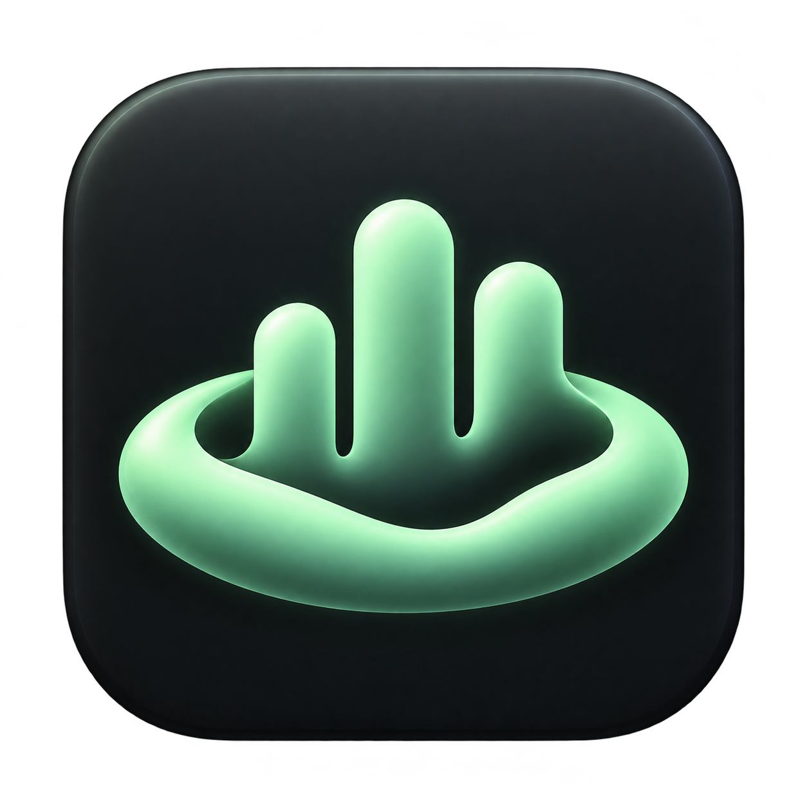
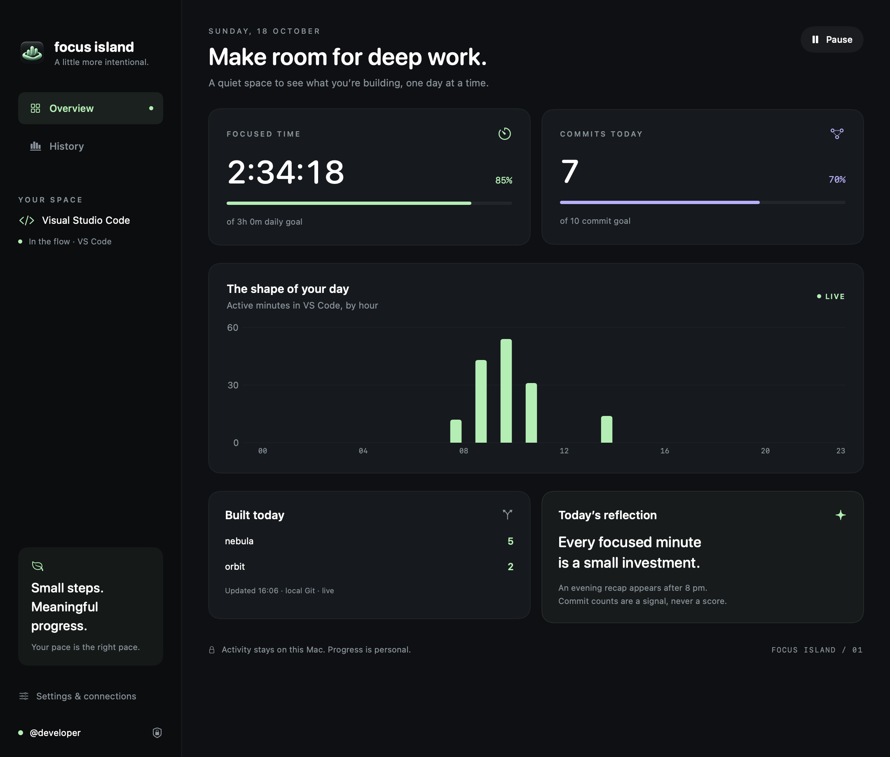
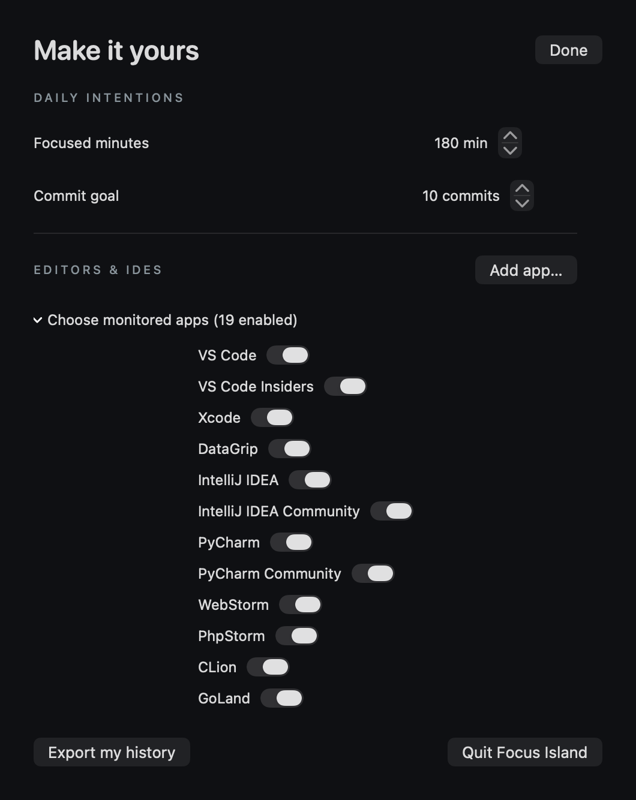
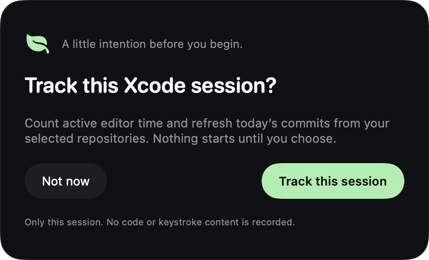
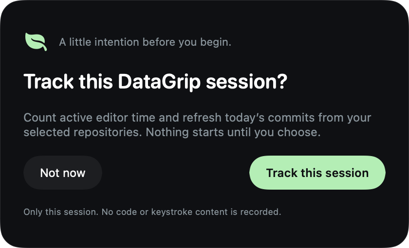
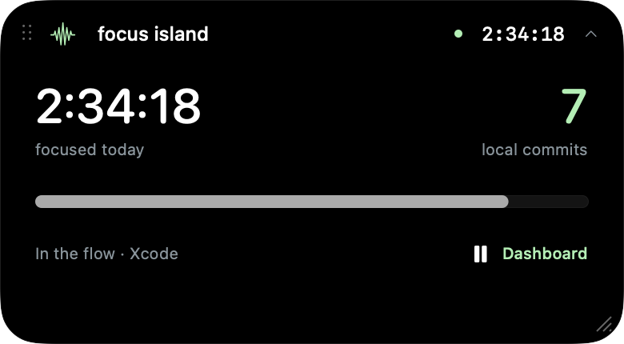
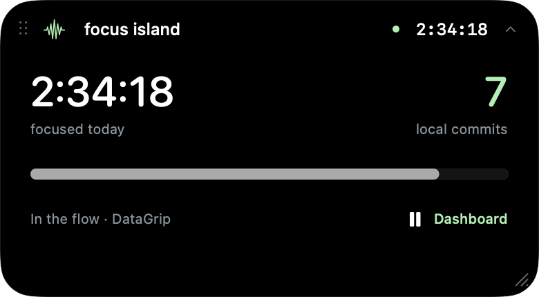
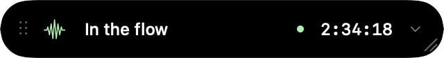

<div align="center">



# Focus Island

**A quiet macOS companion for intentional coding.**

Track active IDE time, see your daily commits, and keep your goals close in a floating island.

macOS 14+ · Swift 6 · SwiftUI + AppKit · MIT

[Get started](#get-started) · [SSH login guide](docs/GETTING-STARTED.md) · [How tracking works](docs/TECHNICAL-NOTES.md) · [Contributing](CONTRIBUTING.md)

</div>



*Interface screenshots use illustrative demo data. No personal activity or credentials are shown.*

## A little more intentional

- **Live focus time.** Counts while your enabled IDE is active, awake, and recently used. Pauses when you switch apps, lock the Mac, or go idle.
- **Your choice, each session.** Opening an enabled IDE asks **Track this session** or **Not now**. Monitoring starts only after acceptance.
- **Daily local commits.** Reads selected Git repositories, including unpushed commits. Filters your author identities and deduplicates hashes across clones.
- **Optional SSH connection.** Verifies your GitHub identity using your existing SSH key and agent. No API token, password, or private-key upload.
- **An island that fits your desk.** Move it across monitors, resize it, or collapse it into a compact status bar. Position and sizes are remembered.
- **A personal dashboard.** Set focus and commit goals, see hourly activity and seven-day history, export JSON, and get an evening recap.

Commit counts are a personal signal, not a measure of code quality or productivity.

## Your IDE, your choice

Built-in support covers VS Code/Insiders, **Xcode**, **DataGrip**, IntelliJ IDEA, PyCharm, WebStorm, PhpStorm, CLion, GoLand, Rider, RubyMine, Android Studio, Cursor, Windsurf, Zed, and Sublime Text.

Open **Settings & connections → Editors & IDEs** to enable or disable individual apps. Use **Add app…** to select any other IDE’s `.app`, including beta/EAP editions with different application identities. The app reads the exact bundle identifier from your selection; it does not track vendor launchers or background helpers by name.

Every running IDE has its own session consent. Enabling an app makes it eligible to ask; it never silently grants permission. Only the foreground, consented IDE contributes time, so switching between two IDEs cannot double count. The dashboard and island show the active IDE’s name. Focus time remains one combined daily total. Terminal-based editors can be tracked by selecting their terminal app; that counts the terminal app’s activity rather than an individual shell program.

<p align="center">
  
</p>

### Xcode and DataGrip in action

Each IDE asks for permission when opened. After you accept, the island follows the foreground IDE and updates your combined daily focus total in real time.

| Xcode session prompt | DataGrip session prompt |
| --- | --- |
|  |  |

| Working in Xcode | Working in DataGrip |
| --- | --- |
|  |  |

*Rendered from the app’s native views with demo data. See the [changelog](CHANGELOG.md) for the latest additions.*

## Meet the island

<p align="center">
  
</p>
<p align="center">
  
</p>

Drag the dotted grip on the left to move it. Drag the lower-right grip to resize; expand it first to adjust height. The menu bar includes **Reset island position and size**.

## Get started

You need macOS 14 or later, Git, and Swift 6 or later. Install a compatible Xcode or Command Line Tools toolchain first.

```sh
git clone https://github.com/ttstive/focus-island.git
cd focus-island
./scripts/build-app.sh
open "dist/Focus Island.app"
```

For Spotlight access, run `./scripts/install-app.sh` to install the icon-bearing app in `~/Applications` and register it with macOS. You can also move **Focus Island.app** from `dist` to an Applications folder yourself. This source build is ad hoc signed; a notarized public binary is not provided yet.

1. Open Focus Island, choose your editors in Settings, then open an enabled IDE.
2. Choose **Track this session** in the prompt.
3. Open **Settings & connections → Add folders…** and select your Git repositories.
4. The app detects Git’s actual author email. Add other author addresses if needed and click **Save emails**.
5. Optionally choose **Connect with SSH key** to verify your GitHub account.

**New to SSH? Follow the [illustrated step-by-step setup guide](docs/GETTING-STARTED.md).** It covers existing keys, new keys, GitHub setup, author emails, and troubleshooting.

<p align="center">
  
</p>

## What gets counted?

| Metric | What it means |
| --- | --- |
| Focused time | Foreground time in an enabled IDE during an accepted session, with less than 60 seconds of input idle time; excludes sleep, lock, and manual pause. |
| Commits today | Unique, reachable commits in selected local repositories, matching your resolved Git author identity or saved email addresses, with a committer timestamp in the current local day. |
| GitHub connection | SSH verification of your account identity. It does not access GitHub’s contribution API. |
| History | Focus totals and the last commit snapshot observed on each recorded day; no historical commit backfill. |

Creating or deleting a file contributes to focused time while you work in an enabled IDE. The commit counter changes when that work is committed to Git. Daily commit counts can include work from earlier in the day; consent controls when scans run. Amend, rebase, deleted refs, shallow history, and author changes can affect counts. See [tracking details](docs/TECHNICAL-NOTES.md).

## Private by design

Activity stays on your Mac. The app records no keystroke content, code, file names, or screenshots. It has no analytics or backend. SSH runs only when you request account verification; local tracking works without it. Exported history contains daily/hourly totals and commit counts, never credentials or repository paths.

Storage, SSH host pinning, timing behavior, and current limitations are documented in [technical notes](docs/TECHNICAL-NOTES.md).

## Development

```sh
swift run FocusCoreChecks
./scripts/check-localgit.sh
./scripts/build-app.sh
```

Open `Package.swift` in Xcode or use `swift run FocusIsland`. No third-party Swift packages are required.

| Directory | Purpose |
| --- | --- |
| `Sources/FocusCore` | Activity rules, session consent, email matching, and commit parsing. |
| `Sources/FocusIsland` | Native UI, activity monitoring, Git scanning, SSH, and persistence. |
| `Tests` | Dependency-free core checks. |
| `scripts` | App packaging and disposable Git integration checks. |
| `docs` | Illustrated onboarding, screenshots, and implementation notes. |

Screenshots can be regenerated from the app’s real views with isolated demo data:

```sh
swift build --product FocusIsland
"$(swift build --show-bin-path)/FocusIsland" --export-screenshots "$PWD/docs/images"
```

The screenshot renderer starts no tracking, Git commands, SSH connections, or preference writes.

## Contributing and license

Issues and pull requests are welcome. Read [CONTRIBUTING.md](CONTRIBUTING.md) and include validation notes. Focus Island is released under the [MIT License](LICENSE).
