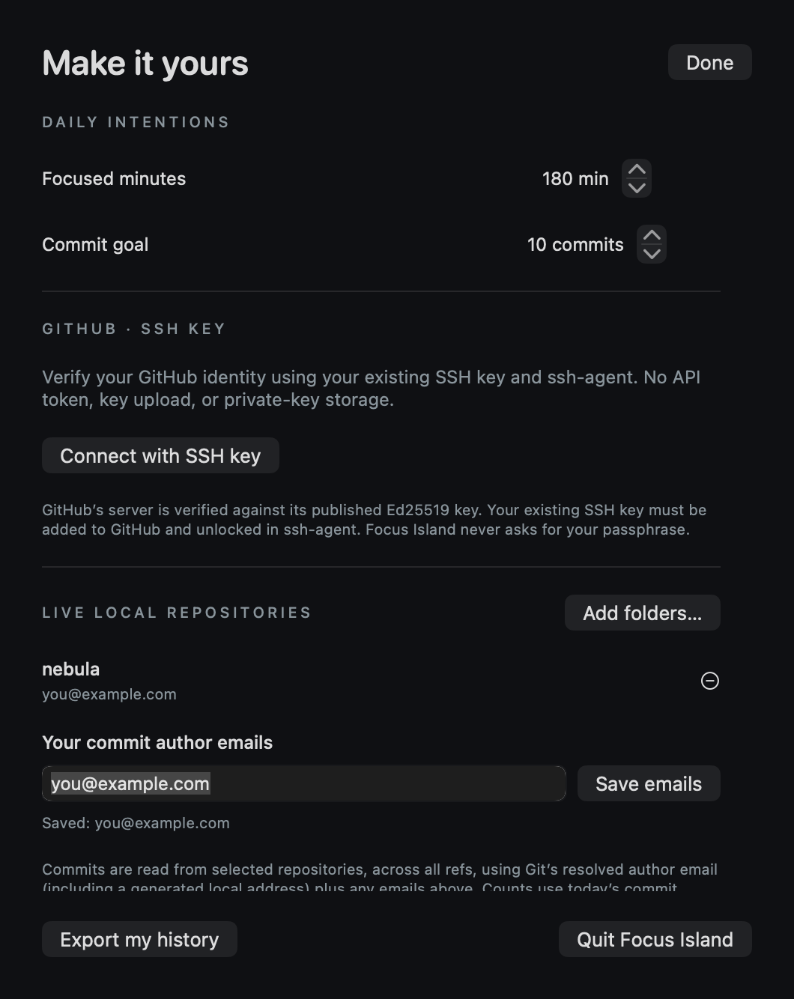
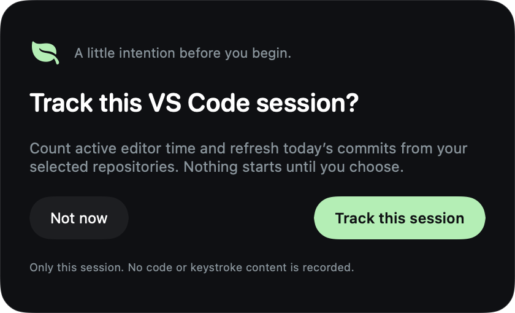
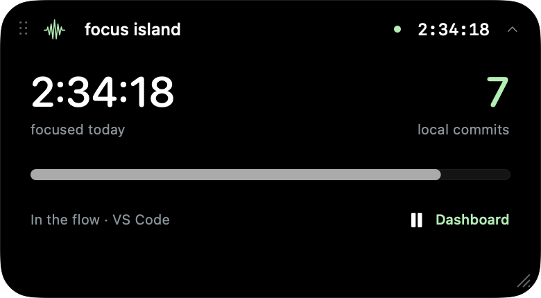

# Get started with Focus Island

This guide walks through installation, optional GitHub login with an SSH key, and the first tracked VS Code session. You never enter your GitHub password or private key into Focus Island.

## 1. Build and open the app

Install macOS 14+ and a Swift 6+ toolchain, then run:

```sh
git clone https://github.com/ttstive/focus-island.git
cd focus-island
./scripts/build-app.sh
open "dist/Focus Island.app"
```

Run `./scripts/install-app.sh` to install **Focus Island.app** in `~/Applications` and register its icon with macOS for Spotlight. You can also move the app to an Applications folder yourself. The current build is ad hoc signed and not notarized.

The waveform icon in the menu bar opens the dashboard, shows/hides the island, pauses tracking, or quits. Closing the dashboard leaves the app running. Launch at login is not enabled automatically.

## 2. Check whether you already have an SSH key

GitHub login is optional. You can skip to step 7 and track local repositories without connecting an account.

If you already push to GitHub using SSH, reuse that setup. In Terminal:

```sh
ssh-add -l
```

A list of fingerprints means your agent has loaded keys. “The agent has no identities” means you need to load one. “Could not open a connection to your authentication agent” means the agent is unavailable in that Terminal session.

You can check for existing public keys with:

```sh
ls -al ~/.ssh/*.pub
```

Do not overwrite an existing key. See GitHub’s [guide to checking existing keys](https://docs.github.com/en/authentication/connecting-to-github-with-ssh/checking-for-existing-ssh-keys).

## 3. Create a key only if you need one

Skip this step if you already have a suitable GitHub authentication key.

Use an unused filename, such as the example below, and choose a passphrase when prompted:

```sh
ssh-keygen -t ed25519 -C "you@example.com" -f ~/.ssh/focus_island_ed25519
```

This creates two files:

| File | Use |
| --- | --- |
| `focus_island_ed25519` | Your **private key**. Keep it on your Mac; never paste it into GitHub or the app. |
| `focus_island_ed25519.pub` | Your **public key**. Add this one to GitHub. |

If the filename already exists, choose another filename rather than replacing it. More options are in GitHub’s [key generation guide](https://docs.github.com/en/authentication/connecting-to-github-with-ssh/generating-a-new-ssh-key-and-adding-it-to-the-ssh-agent).

## 4. Load your key into the macOS SSH agent

Replace the path below with your existing key’s path if you reused a key:

```sh
/usr/bin/ssh-add --apple-use-keychain ~/.ssh/focus_island_ed25519
ssh-add -l
```

Enter your key’s passphrase in Terminal if prompted. Apple’s `--apple-use-keychain` option can remember the passphrase in macOS Keychain. Focus Island never handles it. If the agent is unavailable, follow GitHub’s [macOS agent setup instructions](https://docs.github.com/en/authentication/connecting-to-github-with-ssh/generating-a-new-ssh-key-and-adding-it-to-the-ssh-agent?platform=mac).

## 5. Add the public key to GitHub

Copy the public key:

```sh
pbcopy < ~/.ssh/focus_island_ed25519.pub
```

Then, on GitHub:

1. Open **Settings → SSH and GPG keys**.
2. Choose **New SSH key**.
3. Give it a recognizable title, such as “My Mac”.
4. Select **Authentication Key** as the key type.
5. Paste the public key and choose **Add SSH key**.
6. Complete any GitHub verification prompts yourself.

Only the `.pub` file belongs in that form. GitHub’s [official instructions](https://docs.github.com/en/authentication/connecting-to-github-with-ssh/adding-a-new-ssh-key-to-your-github-account) include screenshots and account-verification details.

## 6. Connect inside Focus Island

Open the dashboard and choose **Settings & connections → Connect with SSH key**.

<p align="center">
  
</p>

*Screenshot uses demo data.*

The app checks GitHub’s server against its bundled, officially published Ed25519 host key, then uses your existing SSH setup to verify your account. You do not need a GitHub token or a separate first-use host-trust prompt.

On success, your `@username` appears in Settings and the sidebar. **Verify again** checks the connection; **Disconnect** forgets the username without deleting or changing your SSH keys.

If you test manually with `ssh -T git@github.com`, verify any first-use server fingerprint against [GitHub’s official fingerprints](https://docs.github.com/en/authentication/keeping-your-account-and-data-secure/githubs-ssh-key-fingerprints) before accepting it. GitHub’s success greeting says authentication succeeded but shell access is unavailable; exit code 1 is expected for this test.

## 7. Choose repositories and author emails

1. In Settings, choose **Add folders…**.
2. Select the local Git repository folders you want to monitor. More than one folder is supported.
3. The app resolves the author identity Git actually uses, including a generated local address if `git config user.email` is unset.
4. Enter any additional author addresses in **Your commit author emails**, separated by commas. These may include your GitHub noreply address.
5. Click **Save emails** or press Return. **Done** also applies a valid draft.
6. Check the **Saved:** line. Incomplete addresses show a validation message and keep the previous saved values.

Your Git commit email can differ from your GitHub login email. To inspect the identity used by a repository, run this from that repository’s folder:

```sh
git var GIT_AUTHOR_IDENT
git log -1 --format='%ae'
```

If older commits use a different address, add it as another saved identity. The app does not modify your Git configuration.

## 8. Open VS Code and choose whether to track

When VS Code or Insiders launches, Focus Island asks:

<p align="center">
  
</p>

- **Track this session** starts active-time monitoring and daily commit refreshes for your selected repositories.
- **Not now** leaves that session untracked. Switching between apps will not repeat the prompt.
- Quitting and reopening VS Code asks again. Starting Focus Island while VS Code is already open also asks.
- The dashboard’s **Start session** button lets you reconsider a skipped session.

Nothing is counted before acceptance. After acceptance, work in the foreground VS Code window and watch the seconds tick on the island. Switching away, sleeping, locking, manual pause, or 60 seconds without input pauses focus time.

## 9. Make a commit and check the dashboard

Work normally in your selected repository, then create a Git commit. You do not need to push it.

Git metadata changes trigger a refresh, with a two-second fallback scan. The dashboard shows today’s matching commits and repository totals. Creating or deleting a file is editor activity, but it is not a commit until you commit the work to Git.

<p align="center">
  
</p>

Daily counts include eligible local commits from earlier that day. They are not GitHub’s contribution-calendar count. See [counting rules and limitations](TECHNICAL-NOTES.md).

## Troubleshooting

| What you see | What to check |
| --- | --- |
| No unlocked keys | Load your key with Apple’s `ssh-add` and confirm `ssh-add -l` lists it. |
| GitHub rejected the key | Add the public authentication key to the intended GitHub account. With several accounts, configure the intended identity in `~/.ssh/config`. |
| Server key mismatch | Stop and compare GitHub’s official fingerprints. A legitimate key rotation requires an app update; do not disable host verification. |
| Network or port 22 blocked | GitHub supports SSH at `ssh.github.com:443`; follow its [port 443 guide](https://docs.github.com/en/authentication/troubleshooting-ssh/using-ssh-over-the-https-port). |
| Timer stays at zero | Accept the session prompt, resume tracking, and bring VS Code to the foreground. Input idle time must be under 60 seconds. |
| Commits stay at zero | Select the correct repository, accept tracking, check author identities, and confirm the commit timestamp falls today. Uncommitted edits do not count. |
| Emails seem unsaved | Use **Save emails**, Return, or **Done**, then check the **Saved:** line. |
| Island is misplaced | Use **Reset island position and size** from the waveform menu. |

For bug reports, include macOS/Swift versions, the app’s status message, and reproduction steps. Never attach private keys, tokens, or personal activity exports to a public issue.
